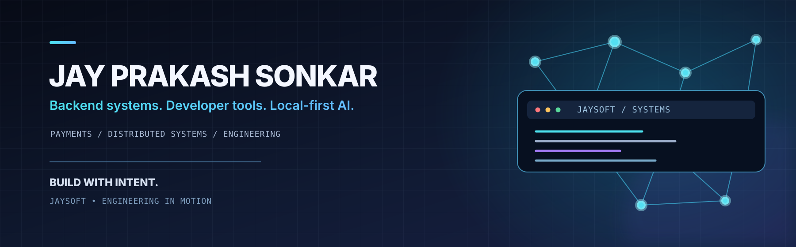

<div align="center">



# Jay Prakash Sonkar

### Software Engineer · Backend Developer · Systems Builder

I turn ideas into reliable, scalable, real-world systems—from payment infrastructure and backend platforms to tools that make engineering work better.

[](https://iamjpsonkar.github.io/portfolio/)
[](https://iamjpsonkar.github.io/portfolio/resume/)
[](https://www.linkedin.com/in/iamjpsonkar/)
[](https://github.com/iamjpsonkar)

</div>

---

## About

I work across **backend engineering, payment systems, distributed systems, developer experience, and infrastructure**.

My professional work has focused on payment and refund systems: gateway integrations, checkout and refund flows, payment methods, API design, reliability, and handling provider failures safely.

Outside work, I build under the **JaySoft** umbrella: developer utilities, engineering tools, browser extensions, learning resources, and practical experiments. The repositories below are grouped so you can explore both current projects and the wider body of work.

> Understand the system deeply. Make the critical path reliable. Turn recurring engineering friction into tools.

## Featured projects

A selection of projects that represent the work I am actively building and learning from.

### [JSAT — JaySoft AI Tools](https://github.com/iamjpsonkar/JaySoft-AI_Tools)

**Persistent codebase intelligence for AI-assisted development.**

JSAT indexes a repository into a persistent graph of code entities and relationships, then exposes that context through a CLI, Python SDK, and MCP server. It is designed to help AI coding tools explore a codebase without repeatedly rediscovering its architecture.

- Repository indexing and graph-backed codebase context
- CLI, Python SDK, and MCP integrations
- Multiple supported AI execution paths, including local and hosted providers
- Live session dashboard for inspecting tool activity
- **[Documentation](https://iamjpsonkar.github.io/JaySoft-AI_Tools/)** · [PyPI](https://pypi.org/project/jsat/) · [Source](https://github.com/iamjpsonkar/JaySoft-AI_Tools)

[](https://pypi.org/project/jsat/)

```bash
pip install jsat
jsat index .
```

### [JaySoft LocalAI](https://github.com/iamjpsonkar/JaySoft-LocalAI)

**A Linux coding agent with a project-managed model runtime.**

Combines a coding-agent runtime with Ollama and a compact coding model. Sessions, repository inspection, edits, commands, and local MCP workflows run on the developer's machine; network-backed tools remain optional.

### [Wave](https://github.com/iamjpsonkar/Wave)

**A local-first workspace for notes, documents, and ideas.**

Wave stores Markdown pages and attachments as portable files in a folder the user chooses. It explores a privacy-conscious, file-based approach to writing, organization, and personal knowledge management.

### [Cloud-Learnings](https://github.com/iamjpsonkar/Cloud-Learnings)

**Hands-on cloud, DevOps, and platform engineering knowledge base.**

Structured material across cloud fundamentals, Linux, networking, AWS, Azure, GCP, containers, Kubernetes, infrastructure as code, CI/CD, security, observability, and practical labs.

### [SystemDesign_Learnings](https://github.com/iamjpsonkar/SystemDesign_Learnings)

**Practical system design notes and case studies.**

A learning path from requirements and capacity estimates through APIs, data models, distributed systems, operations, trade-offs, and worked architecture examples.

### [Learnings](https://github.com/iamjpsonkar/Learnings)

**A hands-on software engineering knowledge base.**

Topic-based notes and runnable examples covering backend development, databases, Docker, Kubernetes, system design, algorithms, web development, and interview preparation.

## Engineering focus

| Area | Focus |
|---|---|
| Backend engineering | Python services, API design, data modelling, integrations, reliability |
| Payment systems | Checkout, gateway integrations, payment methods, refunds, failure handling |
| Distributed systems | Messaging, asynchronous workflows, service boundaries, consistency, resilience |
| Developer tooling | CLIs, automation, repository workflows, code intelligence |
| AI engineering | Model runtimes, MCP, AI-assisted developer workflows |
| Infrastructure | Docker, Kubernetes, Linux, Bash, CI/CD, cloud-native foundations |
| Data | SQL, PostgreSQL, MySQL, Redis, schema design and migrations |

## Professional experience

| Period | Role | Focus |
|---|---|---|
| 2025 – Present | Software Development Engineer II · Fynd | Payment infrastructure, gateway integrations, checkout and refund workflows |
| 2022 – 2025 | Software Development Engineer · Fynd | Backend development across payment, checkout, and refund systems |
| 2020 – 2022 | System Engineer · TCS | Python systems and Yocto-based image upgrades for telecom infrastructure |

## Technology

**Languages:** Python · JavaScript · TypeScript · C/C++ · Java  
**Backend:** Flask · Django · FastAPI · Sanic · REST APIs · SQLAlchemy  
**Data & messaging:** PostgreSQL · MySQL · Redis · Kafka  
**Infrastructure:** Docker · Kubernetes · Linux · Bash · Git · GitHub Actions  
**Exploring:** Rust · MCP · AI-assisted engineering tools

## Learning in public

I maintain practical learning repositories and document concepts through implementation:

- [Learnings](https://github.com/iamjpsonkar/Learnings) — software engineering notes and hands-on examples
- [Cloud-Learnings](https://github.com/iamjpsonkar/Cloud-Learnings) — cloud, infrastructure, and DevOps
- [SystemDesign_Learnings](https://github.com/iamjpsonkar/SystemDesign_Learnings) — architecture and system design

My preferred loop is: **learn the concept → build a working example → test failure modes → document the trade-offs → iterate.**

## Repository directory

The public GitHub account currently has **70 repositories**. This index includes the full set returned by GitHub's repository search on 16 November 2026, grouped by their apparent purpose. Some older experiments and learning repositories are retained alongside actively developed projects.

### JaySoft products and developer tools

- [`JaySoft-AI_Tools`](https://github.com/iamjpsonkar/JaySoft-AI_Tools)
- [`JaySoft-LocalAI`](https://github.com/iamjpsonkar/JaySoft-LocalAI)
- [`JaySoft-DevBox`](https://github.com/iamjpsonkar/JaySoft-DevBox)
- [`JaySoft-KafkaDocker`](https://github.com/iamjpsonkar/JaySoft-KafkaDocker)
- [`JaySoft-KafkaDockerSetup`](https://github.com/iamjpsonkar/JaySoft-KafkaDockerSetup)
- [`JaySoft-Rewind`](https://github.com/iamjpsonkar/JaySoft-Rewind)
- [`JaySoft-JSON-Studio`](https://github.com/iamjpsonkar/JaySoft-JSON-Studio)
- [`JaySoft-MD-Studio`](https://github.com/iamjpsonkar/JaySoft-MD-Studio)
- [`JaySoft_OCR`](https://github.com/iamjpsonkar/JaySoft_OCR)
- [`JaySoft-LearningHub`](https://github.com/iamjpsonkar/JaySoft-LearningHub)
- [`JaySoft-SRTF-CPU`](https://github.com/iamjpsonkar/JaySoft-SRTF-CPU)
- [`JaySoft_TaxHelper`](https://github.com/iamjpsonkar/JaySoft_TaxHelper)
- [`JaySoft-Paint`](https://github.com/iamjpsonkar/JaySoft-Paint)
- [`JaySoft-CourseTemplate`](https://github.com/iamjpsonkar/JaySoft-CourseTemplate)
- [`JaySoftDictionary`](https://github.com/iamjpsonkar/JaySoftDictionary)
- [`JaySoft-ImageViewer`](https://github.com/iamjpsonkar/JaySoft-ImageViewer)
- [`JSText`](https://github.com/iamjpsonkar/JSText)
- [`FastCopy`](https://github.com/iamjpsonkar/FastCopy)
- [`tracerite`](https://github.com/iamjpsonkar/tracerite)

### Cloud, infrastructure and system design

- [`Cloud-Learnings`](https://github.com/iamjpsonkar/Cloud-Learnings)
- [`SystemDesign_Learnings`](https://github.com/iamjpsonkar/SystemDesign_Learnings)
- [`DockerLearn`](https://github.com/iamjpsonkar/DockerLearn)
- [`PostgreSQL_Learnings`](https://github.com/iamjpsonkar/PostgreSQL_Learnings)
- [`Alembic_Learn`](https://github.com/iamjpsonkar/Alembic_Learn)
- [`loghub`](https://github.com/iamjpsonkar/loghub)

### Programming and framework learning

- [`Learnings`](https://github.com/iamjpsonkar/Learnings)
- [`Sanic_Learnings`](https://github.com/iamjpsonkar/Sanic_Learnings)
- [`Sanic_API_Learnings`](https://github.com/iamjpsonkar/Sanic_API_Learnings)
- [`FLASK_Learn`](https://github.com/iamjpsonkar/FLASK_Learn)
- [`Django_learnings`](https://github.com/iamjpsonkar/Django_learnings)
- [`MERN_Learnings`](https://github.com/iamjpsonkar/MERN_Learnings)
- [`Nodejs_Learnings`](https://github.com/iamjpsonkar/Nodejs_Learnings)
- [`WebLearnings`](https://github.com/iamjpsonkar/WebLearnings)
- [`CRUD_Learnings`](https://github.com/iamjpsonkar/CRUD_Learnings)
- [`Optimization_Learnings`](https://github.com/iamjpsonkar/Optimization_Learnings)
- [`ML_Learnings`](https://github.com/iamjpsonkar/ML_Learnings)
- [`Algorithm_learnings`](https://github.com/iamjpsonkar/Algorithm_learnings)
- [`DS_ALGO`](https://github.com/iamjpsonkar/DS_ALGO)
- [`InterviewPrep_Learnings`](https://github.com/iamjpsonkar/InterviewPrep_Learnings)
- [`Tkinter_Learn_udemy`](https://github.com/iamjpsonkar/Tkinter_Learn_udemy)
- [`SocketProgramming_FirstApp`](https://github.com/iamjpsonkar/SocketProgramming_FirstApp)

### Applications and experiments

- [`MusicPlayer`](https://github.com/iamjpsonkar/MusicPlayer)
- [`Youtube_trending`](https://github.com/iamjpsonkar/Youtube_trending)
- [`Connect4-begginer-game`](https://github.com/iamjpsonkar/Connect4-begginer-game)
- [`H2E-translator`](https://github.com/iamjpsonkar/H2E-translator)
- [`LibraryManagementApp`](https://github.com/iamjpsonkar/LibraryManagementApp)
- [`BIETcoders`](https://github.com/iamjpsonkar/BIETcoders)
- [`IASTool`](https://github.com/iamjpsonkar/IASTool)
- [`Microblog`](https://github.com/iamjpsonkar/Microblog)
- [`travel-app`](https://github.com/iamjpsonkar/travel-app)
- [`adventureGame`](https://github.com/iamjpsonkar/adventureGame)
- [`JSContacts`](https://github.com/iamjpsonkar/JSContacts)
- [`Vue-Ecommerce-Frontend`](https://github.com/iamjpsonkar/Vue-Ecommerce-Frontend)
- [`InterviewRoom`](https://github.com/iamjpsonkar/InterviewRoom)
- [`MyBlog`](https://github.com/iamjpsonkar/MyBlog)
- [`HelloApp`](https://github.com/iamjpsonkar/HelloApp)
- [`WeAreCoders`](https://github.com/iamjpsonkar/WeAreCoders)
- [`FlaskCRUD_BMS`](https://github.com/iamjpsonkar/FlaskCRUD_BMS)
- [`SanicCRUD_BMS`](https://github.com/iamjpsonkar/SanicCRUD_BMS)
- [`TurtleMove`](https://github.com/iamjpsonkar/TurtleMove)
- [`JSview`](https://github.com/iamjpsonkar/JSview)

### References and upstream projects

- [`sanic`](https://github.com/iamjpsonkar/sanic)
- [`claw-code`](https://github.com/iamjpsonkar/claw-code)
- [`system-prompts-and-models-of-ai-tools`](https://github.com/iamjpsonkar/system-prompts-and-models-of-ai-tools)
- [`generative-ai-for-beginners`](https://github.com/iamjpsonkar/generative-ai-for-beginners)
- [`google-10000-english`](https://github.com/iamjpsonkar/google-10000-english)
- [`material-dashboard-react`](https://github.com/iamjpsonkar/material-dashboard-react)

### Personal projects and profile

- [`Wave`](https://github.com/iamjpsonkar/Wave)
- [`portfolio`](https://github.com/iamjpsonkar/portfolio)
- [`iamjpsonkar`](https://github.com/iamjpsonkar/iamjpsonkar)

## Explore

<div align="center">

[**Portfolio & case studies**](https://iamjpsonkar.github.io/portfolio/) · [**Résumé**](https://iamjpsonkar.github.io/portfolio/resume/) · [**All repositories**](https://github.com/iamjpsonkar?tab=repositories) · [**LinkedIn**](https://www.linkedin.com/in/iamjpsonkar/)

### Interested in backend platforms, payment systems, or developer tooling?

I enjoy building systems that make important workflows more dependable and engineering work easier to understand.

</div>
